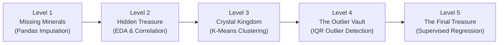
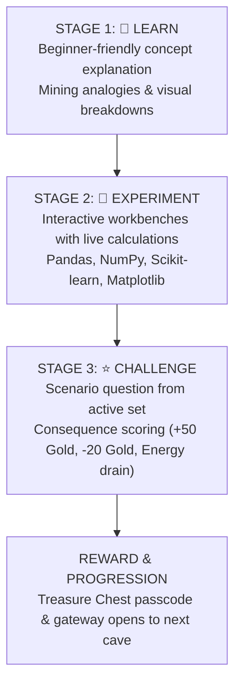

# DATA MINER: THE TREASURE HUNT ⛏️💎
### *An Interactive 2D Adventure Game for Learning Data Science with Python*

Developed as part of the **Introduction to Data Science with Python** course (Part B: Gamified Learning Environment).

---

## 1. Project Introduction

**DATA MINER: THE TREASURE HUNT** is a fully playable 2D top-down adventure game set in a warm, richly illustrated subterranean treasure cave. Rather than delivering passive lectures, slides, or standard web quizzes, this project immerses the player in an exploratory mining expedition where mastering foundational Data Science concepts is the only way to disarm anomalies, analyze datasets, and unlock the Ancient Vault of Gold.

The game communicates in real time between an HTML5 Canvas frontend and a Python Flask backend. Every statistical measure, imputation technique, scatter plot, clustering routine, machine learning prediction, and **challenge question answer** is calculated dynamically using **Pandas**, **NumPy**, **Scikit-learn**, and mathematical formulas—ensuring students learn through real computation, experimentation, and decision-making rather than memorizing hardcoded answers.

---

## 2. Game Objectives

- **Primary Goal**: Explore 5 subterranean cave levels, mine mineral deposits, manage suit battery, analyze sensor datasets at Ancient Data Terminals, and unlock the Mountain King's Golden Chest.
- **Pedagogical Goal**: Teach genuine Data Science workflows through practical gameplay choices and active experimentation rather than abstract theory.
- **Interactive Outcomes**:
  - Make data-driven decisions based on live statistical computations.
  - Understand the consequences of improper data treatment (e.g., losing sample variance from aggressive row dropping, choosing weak predictors, or failing to identify extreme statistical outliers).
  - Discover mathematical and statistical properties dynamically (median robustness against outliers, feature scale dominance in Euclidean distance, Pearson $r$ vs. $R^2$, and train/test generalization gaps).

---

## 3. How-to-Play Guide

### Controls
| Key / Input | Action |
| :--- | :--- |
| **Arrow Keys** or **WASD** | Move miner in 4 directions through cave pathways |
| **Spacebar** | Swing pickaxe to mine cracked ore rocks / open chests |
| **E Key** or **Enter** | Interact with Ancient Data Terminals and Treasure Chests |
| **Escape** | Pause / open in-game menu |
| **Mouse Click** | Navigate interactive workbench tabs, buttons, and quizzes |

### Game Mechanics & Survival Rules
- **Lives & Health**: The miner begins with 3 lives (❤️). Extreme energy depletion or hazardous mistakes reduce lives.
- **Suit Battery (⚡)**: Walking through cave corridors and swinging the pickaxe drains energy. 
- **One-Time Charging Capsules (⚡)**: Yellow energy capsules scattered across the caverns grant a strict **+3% battery boost** (capped cleanly at 100%, e.g., 98% $\rightarrow$ 100%, 99% $\rightarrow$ 100%). Each capsule is single-use and permanently disappears upon collection; if battery is already 100%, the capsule remains intact on the ground.
- **Mined Minerals & XP**: Mining rock veins (Ruby, Emerald, Diamond, Gold, Amethyst) awards gold coins and experience points.
- **Ancient Data Terminals**: Stand near terminals and press `[E]` to access the 3-stage learning workbench. Complete the data science challenge to unlock the room's Gold Chest passcode.
- **Dynamic Feedback**: Terminal analysis gives instant diagnostic feedback. Correct submissions award **+50 Gold**, **+100 XP**, and the chest passcode; incorrect submissions deduct charging energy (-12%) and provide targeted hints without prematurely giving away the answer.

---

## 4. Visual Art & Environment Overhaul

The game features a warm, rich visual aesthetic designed to feel like an inviting underground treasure cavern:

- **Natural Soil Ground**: Rich terracotta and warm sandy-brown subterranean ground with natural grain, tiny stones, and organic pebbles.
- **Realistic Wooden Planks**: Custom-illustrated medium oak and walnut plank barriers with visible grain, divisions, knots, and soft contact shadows forming the maze structure.
- **Cave Boundaries & Rock Formations**: Layered reddish-brown and earthy cave walls with mineral crystal clusters (emerald, cyan, amber, and amethyst).
- **Adventure HUD**: Dark-oak wooden panels with thin golden brass borders, clean retro typography, responsive battery meters, and heart containers.
- **Ancient Data Terminal Modal**: Beveled dark-oak frame (`#24150d`, `#331e12`) with golden borders (`#d4973b`), parchment tables, and warm honey-gold stage navigation tabs.

---

## 5. Data Science Concepts Covered



1. **Level 1: The Missing Minerals (Data Cleaning & Imputation)**
   - *Concept*: Handling missing data ($NaN$).
   - *Mechanic*: Damaged sensor logs require imputation. Player evaluates **Mean**, **Median**, and **Row Dropping** strategies.
   - *Learning*: Skewed distributions favor Median over Mean; dropping rows causes irreversible sample size loss.

2. **Level 2: The Hidden Treasure (Exploratory Data Analysis & Correlation)**
   - *Concept*: Descriptive statistics, Pearson correlation coefficient ($r$), and bivariate scatter plots.
   - *Mechanic*: Player analyzes correlation between mineral features and market value to locate the richest geological vein.
   - *Learning*: Identifying linear relationships using correlation matrices and scatter trend lines; understanding that correlation does not imply causation.

3. **Level 3: The Crystal Kingdom (Unsupervised K-Means Clustering)**
   - *Concept*: K-Means clustering, centroid calculation, cluster inertia, and multidimensional feature spaces.
   - *Mechanic*: Hundreds of unclassified crystal samples are partitioned using Scikit-learn. Player adjusts $K$ and pinpoints rare crystal clusters.
   - *Learning*: Unsupervised grouping of unlabeled data based on Euclidean distance metrics.

4. **Level 4: The Outlier Vault (Statistical Outlier Detection)**
   - *Concept*: Quartiles ($Q_1$, $Q_3$), Interquartile Range ($IQR$), Box-and-Whisker plots, and Outlier Boundaries.
   - *Mechanic*: Geological samples contain extreme measurement anomalies. Player applies the $1.5 \times IQR$ rule to isolate anomalous specimens:
     $$\text{Upper Outlier Boundary} = Q_3 + 1.5 \times IQR$$
     $$\text{Lower Outlier Boundary} = Q_1 - 1.5 \times IQR$$
   - *Learning*: Non-parametric distribution summaries and quantitative thresholding without non-syllabus narrative metaphors.

5. **Level 5: The Final Treasure (Supervised Regression & Model Evaluation)**
   - *Concept*: Train/Test split (80/20), Simple Linear Regression, Decision Tree Regressor, Random Forest Regressor, MAE, and RMSE.
   - *Mechanic*: The vault requires an accurate gem valuation prediction. Player trains models on training data, evaluates generalization performance on unseen test samples, and selects the champion model.
   - *Learning*: Model comparison, overfitting vs. generalization, and loss evaluation metrics.

---

## 6. Experiential Learning System: Three Stages in Every Level

The game follows an interactive pedagogical cycle: **LEARN → EXPERIMENT → DISCOVER → CHALLENGE → REWARD**.
When reaching an Ancient Terminal and pressing `[E]`, players experience three structured stages:



### Stage 1: LEARN (Concept Explanation & Real-World Analogies)
- **Level 1**: Missing values ($NaN$), expedition map analogies, and the tradeoff between row dropping vs. mean vs. median imputation.
- **Level 2**: Exploratory data analysis, Pearson correlation ($r \in [-1, +1]$), scatter plots, and correlation vs. causation.
- **Level 3**: Unsupervised grouping by physical similarity, centroids, Euclidean distance, and cluster inertia.
- **Level 4**: Statistical anomaly detection, box plots, quartiles ($Q_1, Q_3$), $IQR$, and $1.5 \times IQR$ outlier boundaries.
- **Level 5**: Continuous value prediction, 80/20 train/test splitting, overfitting vs. generalization, and evaluation metrics (MAE, RMSE, $R^2$).

### Stage 2: EXPERIMENT (Hands-On Interactive Workbenches)
- **Level 1 Imputation Workbench**: Select Median Imputation, Mean Imputation, or Row Dropping. Calls `/api/level1/clean` via Pandas, displaying before/after preview tables, retained vs. lost samples, and computed column stats.
- **Level 2 Correlation Radar**: Select any geological feature (Crystal Size, Hardness, Weight, Extraction Depth) to dynamically generate Matplotlib OLS scatter plots, calculate Pearson $r$, and view relationship strength.
- **Level 3 Clustering Studio**: Toggle $K \in \{2, 3, 4, 5\}$ to run Scikit-learn KMeans, view live cluster scatter maps with centroids, inspect inertia, and observe cluster separation.
- **Level 4 Outlier Detection Lab**: Adjust the IQR multiplier ($1.0\times, 1.5\times, 2.0\times, 2.5\times$) to recalculate upper/lower boundaries, view distribution box plots, and discover how multiplier sensitivity affects anomaly classification.
- **Level 5 Regression Arena**: Train Random Forest, Decision Tree, or Linear Regression on the dataset. Inspect test set leaderboards, actual vs. predicted test scatter plots, and vault gem predictions.

### Stage 3: CHALLENGE & CONSEQUENCE SYSTEM
- Players apply what they discovered in the challenge mode.
- **Real Game Consequences**:
  - **Correct Answer**: Awarded **+50 Gold** and **+100 XP**; unlocks the room's Treasure Chest passcode.
  - **Incorrect Answer**: Deducts **20 Gold** (clamped at 0); provides diagnostic hints without revealing the answer.
  - **Repeated Incorrect Attempts**: Further deducts **12% Energy** (or health/lives if depleted).
  - **Experimentation is Free**: Exploring and testing different settings in Stage 2 carries **no penalties**, encouraging discovery and curiosity.

---

## 7. Dynamic Question Bank & Zero-Hardcoding Engine

Whenever an expedition begins, the game dynamically selects one of **3 Question Sets** (consistent across all 5 levels per playthrough for narrative continuity):

- **Set 1: The Lost Expedition**
  - *Level 1*: Missing value median computation on observed array $[10, 12, 14, \text{NaN}, 18, 100] \implies \text{Median} = 14$.
  - *Level 2*: Strongest negative correlation identification from correlation telemetry $\min(r) \implies \text{Hardness}\ (r = -0.18)$.
  - *Level 3*: K-Means mathematical objective function: minimization of Inertia / WCSS ($\min \sum \|x_i - \mu_k\|^2$).
  - *Level 4*: Upper outlier boundary computation with $Q_1 = 20, Q_3 = 40 \implies \text{Upper Bound} = Q_3 + 1.5 \times \text{IQR} = 70$.
  - *Level 5*: Comparative regression evaluation ($\text{MAE}$ vs. $\text{RMSE}$ tradeoff between Model A and Model B).

- **Set 2: The Crystal Labyrinth**
  - *Level 1*: Robust imputation under right-skewed price distributions (median resistance to extreme outliers).
  - *Level 2*: Pearson correlation calculation using formula $r = \frac{\text{Cov}(X,Y)}{\sigma_X \sigma_Y} = \frac{320}{4 \times 100} = 0.80$.
  - *Level 3*: Feature scale dominance in Euclidean distance ($\Delta W^2 \gg \Delta H^2$) and the necessity of standardization ($z = \frac{x-\mu}{\sigma}$).
  - *Level 4*: Multi-step quartile and outlier detection on $[12, 15, 18, 20, 22, 24, 26, 28, 30, 100] \implies Q_1=18, Q_3=28, \text{IQR}=10, \text{Outlier}=\text{Yes}$.
  - *Level 5*: Bias-variance error diagnosis: severe disparity ($\text{Train RMSE}=2$, $\text{Test RMSE}=25$, ratio $12.5\times$) indicates overfitting.

- **Set 3: The Final Diamond Vault**
  - *Level 1*: Data leakage prevention: estimating preprocessing parameters exclusively on $\mathcal{D}_{\text{train}}$ before transforming $\mathcal{D}_{\text{test}}$.
  - *Level 2*: Correlation vs. causation and coefficient of determination $R^2 = r^2 = 0.95^2 = 0.9025$ ($90.25\% \neq 95\%$).
  - *Level 3*: Euclidean distance calculation to cluster centroids: $d(P, C_i) = \sqrt{(x_P - x_{C_i})^2 + (y_P - y_{C_i})^2}$ identifying nearest centroid $C_3$.
  - *Level 4*: Outlier handling domain best practice: investigate whether extreme samples are sensor errors or genuine anomalies before filtering.
  - *Level 5*: Model leaderboard comparison: identifying the model with lowest test error $\min(\text{RMSE}) \implies \text{Random Forest}$.

---

## 8. Playtesting Feedback System & Peer Evidence

The game features an integrated peer-testing evaluation system:
1. **In-Game Submission**: Click **"Explorer Reviews"** or **"Feedback"** from the main menu, victory screen, or game over screen.
2. **Form Attributes**: Name/Codename, Star Rating ($1 - 5$), Perceived Difficulty, Learning Experience, Gameplay Rating, Most Challenging Level, and suggestions.
3. **Persistent SQLite Database**: Records are validated and stored in `datasets/player_feedback.db`.
4. **Community Reviews Modal**: Browse live peer evaluations via `GET /api/feedback/public`.
5. **Statistical Summary**: Aggregate metrics (average rating, difficulty breakdown, learning efficacy percentage) via `GET /api/feedback/summary`.
6. **CSV Export**: Download complete playtest records as a formatted CSV via `GET /api/feedback/export`.
7. **Instructor / Developer Report Page**: Access the live analytics dashboard at `http://127.0.0.1:5000/feedback-report`.

---

## 9. Automated Testing & Verification

An automated test suite is provided in `tests/test_backend.py`.

```bash
python -m unittest discover tests
```

### Execution Output:
```text
...........
----------------------------------------------------------------------
Ran 11 tests in 4.955s

OK
```
All unit tests verify:
- Complete missing value resolution under Mean, Median, and Drop methods.
- Calculation of Pearson correlation matrices and strongest feature identification.
- K-Means convergence, centroid generation, and cluster detection across $K \in \{2, 3, 4\}$.
- IQR calculation and outlier classification accuracy.
- Model training, evaluation metrics ($MAE$, $RMSE$, $R^2$), and vault combination prediction across all 3 regressors.
- Flask endpoints response codes ($200\text{ OK}$) and JSON schema verification.
- **Dynamic question solver calculations** across all 15 questions in Sets 1, 2, and 3.
- Peer feedback SQLite database persistence, statistical aggregation, and automatic test record cleanup.

---

## 10. Installation & Running Instructions

### Prerequisites
- Python 3.9 or higher
- Modern web browser (Chrome, Edge, Firefox)

### Setup
```bash
# 1. Clone or navigate to the project directory
cd DataMining

# 2. Install dependencies
python -m pip install -r requirements.txt

# 3. Generate datasets (if not already created)
python data_science/data_generator.py

# 4. Run the automated test suite
python -m unittest discover tests

# 5. Launch the game server
python app.py
```

### Playing the Game
Open your browser and navigate to:
```
http://127.0.0.1:5000
```
Click **► PLAY GAME**, use **WASD / Arrow Keys** to move, **Spacebar** to mine, and **E** to scan!
